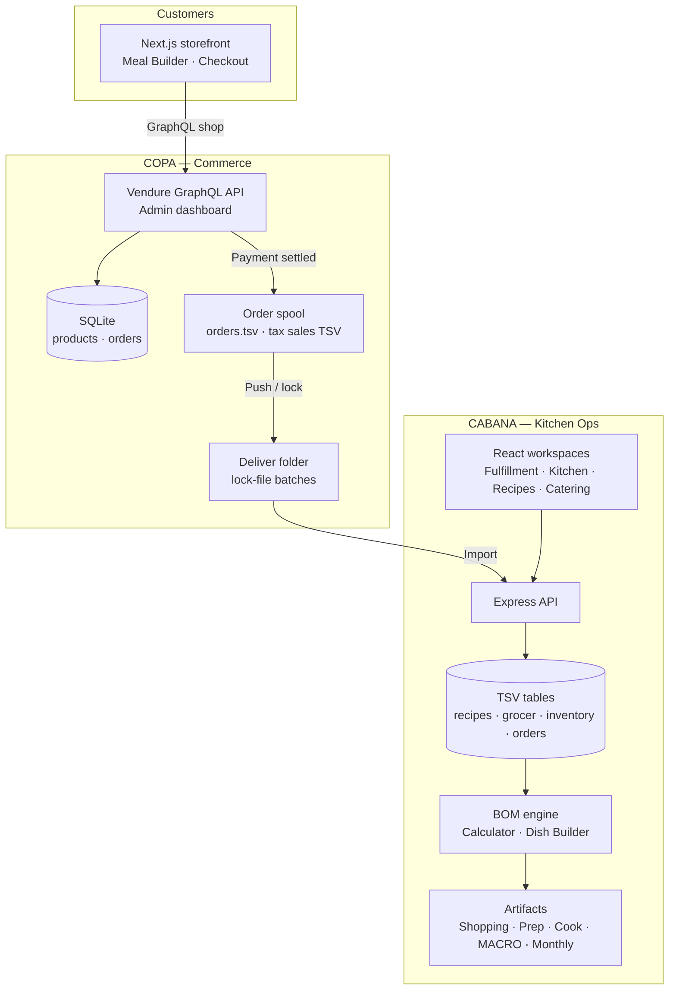

# COPA CABANA

Operational analytics for a weekly meal-prep kitchen in Houston.

**COPA** is the customer storefront: a Next.js shop on a Vendure commerce API. Customers compose a meal, see rolled-up nutrition, leave a kitchen note, and check out into a structured order.

**CABANA** is the staff application. It turns those orders into a bill of materials, a shopping list, prep and cook sheets, and a week-level production summary. It runs locally for the kitchen. It was never the public website.

Daryl Trinidad designed and built both. The shop stopped taking orders in August 2026. The AWS host stayed up until it was terminated in September 2026. Source for both production apps stays in private repositories. Real recipes, formulas, and costs stay private too. This repo is the public account of how the two systems fit together, plus a small runnable sketch on invented orders and prices. Citrus Herb Chicken is a made-up dish.

## What the kitchen has to answer

A catering week is an analytics problem:

- What did customers commit to?
- Which ingredients and sub-recipes does that imply, once sauces sit inside dishes and dishes sit inside meals?
- What is already on hand, in which unit?
- What must be bought, prepped, and cooked, and in what order?

Spreadsheets fail when the menu nests, when weight is stored as ounces under a `lb:oz` unit, and when a line moves from received to cooking to packaged to complete. The public site still has to show nutrition and pickup instructions. The kitchen still needs a list it can shop and a sheet it can print.

## How an order becomes a shopping list



1. A customer builds a meal and pays.
2. The commerce server stores the order and appends one TSV row per line, plus a tax-sales row for the order.
3. A push renames the live spool to a timestamped lock file and keeps an archive copy.
4. CABANA imports that lock file into current orders.
5. Fulfillment summarizes the week. Lines advance Received → Cook → Package → Complete.
6. Kitchen demand keeps pending, Received, Cook, and Package lines, drops Complete, explodes recipes, nets inventory, and writes the shopping, prep, and cook outputs.

## Walk the sample

The sketch in [`cabana/`](cabana/README.md) reads fictional TSV tables and prints demand, a nested bill of materials, and a shopping list. One ingredient is deliberately in the wrong unit so the run flags it instead of inventing a conversion.

```bash
node cabana/demo.mjs
```

No install. Node 20 or newer.

## In this repo

| Path | What it is |
|------|------------|
| [docs/case-study.md](docs/case-study.md) | Full narrative of the two systems |
| [docs/architecture.md](docs/architecture.md) | Layers, handoff, and what each side owns |
| [storefront/README.md](storefront/README.md) | What the public shop did |
| [cabana/README.md](cabana/README.md) | Tables, rules, and how the sketch differs from the staff app |
| [cabana/sample-data/](cabana/sample-data/) | Invented grocer, recipe, inventory, and order files |

## What is not here

Real recipes, formulas, supplier costs, customer names, emails, orders, tax filings, hostnames, keys, and deploy credentials are not in this repository. The files under `cabana/sample-data/` are written for the demo. They are not an export from the kitchen.
