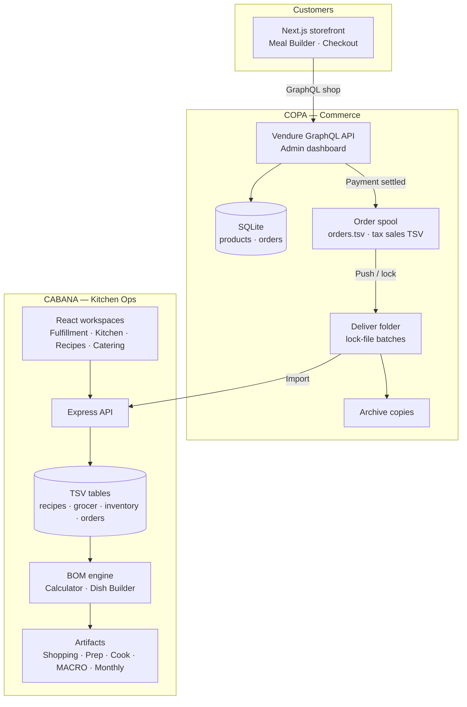

# Architecture

COPA is the commerce system. CABANA is the kitchen system. They meet in a lock file: a timestamped TSV snapshot of settled order lines.

No hostnames, credentials, or machine paths belong in this document.

## System context

## Layer responsibilities

| Layer | Role | Primary data |
|-------|------|----------------|
| **Storefront** | Meal composition, nutrition panel, cart and checkout, order-window messaging | GraphQL order lines with meal groups, a nutrition string, and kitchen notes |
| **Vendure server** | Catalog, pricing, payments, email, meal-menu import and export | SQLite and static assets |
| **Order operations** | Append TSV when payment settles; lock, deliver, archive; tax-sales file in parallel | TSV rows and lock filenames |
| **Kitchen Ops API** | Reject bad headers, read and write tables atomically, patch order status, import a lock file | Grocer costs, recipes, recipe lines, inventory, current and archived orders |
| **Analytics UI** | Filter demand by status, explode the BOM, net inventory, summarize the week, queue catering batches | Shortages, costs, and rollups |

## Order handoff

1. Checkout completes. Order lines land in SQLite.
2. A writer appends one row per line to the live orders spool, and one tax-sales row per order.
3. A scheduled or manual push renames the spool to `_LOCK_<timestamp>_orders.tsv` in the deliver folder. The archive keeps a copy.
4. CABANA imports the latest lock file into current orders.
5. MACRO, Kitchen, and Catering read current orders plus the recipe tables and produce operational output.

Imports reject a file whose header does not match the canonical column order. Quoted fields may contain commas. That rule is what keeps a notes column from shifting every column to its right.

## Production shape

The commerce stack built as one Node host behind nginx: TLS at the proxy, the API and the storefront on the same machine. CABANA stayed a local staff app — browser plus API on the kitchen machine — and did not replace the public site.

The shop stopped taking orders in August 2026. The AWS host was terminated in September 2026. CABANA remains the local tool for the kitchen. Neither codebase is published here.

## Related pages

- [Case study](case-study.md)
- [Storefront](../storefront/README.md)
- [CABANA sample](../cabana/README.md)
